# 05 - ความสัมพันธ์ของข้อมูล (ERD)

ทั้งหมด 80 ความสัมพันธ์เป็นแบบ **many-to-one** (ลูกค้าหนึ่งแถวอ้างอิงแม่หนึ่งแถว) ไม่มี many-to-many โดยตรง

## แผนภาพ (ตารางจริง)

```mermaid
erDiagram
    Acknowledge_Logs {
        string _key
    }
    Announcements {
        string _key
    }
    Doc_Return {
        string _key
    }
    FILTER {
        string _key
    }
    Image_Doc_Return {
        string _key
    }
    PDF_______ {
        string _key
    }
    PriceOverride {
        string _key
    }
    Price_Table {
        string _key
    }
    SCG_______JWD_______ {
        string _key
    }
    ScanDocs {
        string _key
    }
    T________________ {
        string _key
    }
    T________________________ {
        string _key
    }
    T__________RT {
        string _key
    }
    T__________RW {
        string _key
    }
    T___________________________ {
        string _key
    }
    T______________ {
        string _key
    }
    T_________________ {
        string _key
    }
    T_______________Scg_______ {
        string _key
    }
    T_______________2 {
        string _key
    }
    T_________________200 {
        string _key
    }
    T_________________2 {
        string _key
    }
    T_________________________2 {
        string _key
    }
    T______Shipment {
        string _key
    }
    T___________________ {
        string _key
    }
    T__________________2 {
        string _key
    }
    T____________ {
        string _key
    }
    T______________________________ {
        string _key
    }
    T_________ {
        string _key
    }
    T_____________________ {
        string _key
    }
    SCG_______JWD_______ }o--|| Doc_Return : "ID_Doc_Return"
    SCG_______JWD_______ }o--|| T_________________ : "SM_Link_SCG"
    SCG_______JWD_______ }o--|| T______________ : "ID_พนักงาน"
    T________________________ }o--|| T______________ : "ID_พนักงาน"
    T________________ }o--|| T______________ : "ID_พนักงาน"
    T_____________________ }o--|| T_________________ : "SM_Link"
    T_____________________ }o--|| T__________RT : "RT_Link"
    T_____________________ }o--|| T______________ : "ID_พนักงาน"
    T_________________200 }o--|| T______________ : "ID_พนักงาน"
    T__________________3 }o--|| SCG_______JWD_______ : "_ComputedKey_ID_SCGนครหลวงJWDภูมิภาค"
    Image_Doc_Return }o--|| Doc_Return : "ID_Doc_Return"
    T_______________Scg_______ }o--|| SCG_______JWD_______ : "ID_SCGนครหลวงJWDภูมิภาค"
    T_______________Scg_______ }o--|| T______________ : "ID_พนักงาน"
    ScanDocs }o--|| T_________________ : "Invoice_No"
    T______________________________ }o--|| T______________ : "ID_พนักงาน"
    Acknowledge_Logs }o--|| Announcements : "ID_ประกาศ"
```

## ตารางความสัมพันธ์ทั้งหมด

| จากตาราง | คอลัมน์ | -> ตาราง | key ของปลายทาง | ชนิดตารางปลายทาง |
|---|---|---|---|---|
| `SCGนครหลวงJWDภูมิภาค` | `ID_Doc_Return` | `Doc_Return` | `ID_Doc_Return` | business |
<!-- rel: SCGนครหลวงJWDภูมิภาค -> Doc_Return -->
| `SCGนครหลวงJWDภูมิภาค` | `SM_Link_SCG` | `ตารางงานประจำวัน` | `ID_งานประจำวัน` | business |
<!-- rel: SCGนครหลวงJWDภูมิภาค -> ตารางงานประจำวัน -->
| `SCGนครหลวงJWDภูมิภาค` | `ID_พนักงาน` | `ข้อมูลพนักงาน` | `ID_พนักงาน` | business |
<!-- rel: SCGนครหลวงJWDภูมิภาค -> ข้อมูลพนักงาน -->
| `ข้อมูลการเข้าบำรุงรักษา` | `ID_พนักงาน` | `ข้อมูลพนักงาน` | `ID_พนักงาน` | business |
<!-- rel: ข้อมูลการเข้าบำรุงรักษา -> ข้อมูลพนักงาน -->
| `ข้อมูลการวางบิล` | `ID_พนักงาน` | `ข้อมูลพนักงาน` | `ID_พนักงาน` | business |
<!-- rel: ข้อมูลการวางบิล -> ข้อมูลพนักงาน -->
| `แจ้งปั ญหาระหว่างวัน` | `SM_Link` | `ตารางงานประจำวัน` | `ID_งานประจำวัน` | business |
<!-- rel: แจ้งปั ญหาระหว่างวัน -> ตารางงานประจำวัน -->
| `แจ้งปั ญหาระหว่างวัน` | `RT_Link` | `ข้อมูลงานRT` | `ID_RT` | business |
<!-- rel: แจ้งปั ญหาระหว่างวัน -> ข้อมูลงานRT -->
| `แจ้งปั ญหาระหว่างวัน` | `ID_พนักงาน` | `ข้อมูลพนักงาน` | `ID_พนักงาน` | business |
<!-- rel: แจ้งปั ญหาระหว่างวัน -> ข้อมูลพนักงาน -->
| `รับงานคืนได้เงิน200` | `ID_พนักงาน` | `ข้อมูลพนักงาน` | `ID_พนักงาน` | business |
<!-- rel: รับงานคืนได้เงิน200 -> ข้อมูลพนักงาน -->
| `สรุปเบิกส่วนต่าง` | `_ComputedKey_ID_SCGนครหลวงJWDภูมิภาค` | `SCGนครหลวงJWDภูมิภาค` | `ID_SCGนครหลวงJWDภูมิภาค` | business |
<!-- rel: สรุปเบิกส่วนต่าง -> SCGนครหลวงJWDภูมิภาค -->
| `Image_Doc_Return` | `ID_Doc_Return` | `Doc_Return` | `ID_Doc_Return` | business |
<!-- rel: Image_Doc_Return -> Doc_Return -->
| `ทำเบิกส่วนต่างScgวังน้อย` | `ID_SCGนครหลวงJWDภูมิภาค` | `SCGนครหลวงJWDภูมิภาค` | `ID_SCGนครหลวงJWDภูมิภาค` | business |
<!-- rel: ทำเบิกส่วนต่างScgวังน้อย -> SCGนครหลวงJWDภูมิภาค -->
| `ทำเบิกส่วนต่างScgวังน้อย` | `ID_พนักงาน` | `ข้อมูลพนักงาน` | `ID_พนักงาน` | business |
<!-- rel: ทำเบิกส่วนต่างScgวังน้อย -> ข้อมูลพนักงาน -->
| `ScanDocs` | `Invoice_No` | `ตารางงานประจำวัน` | `ID_งานประจำวัน` | business |
<!-- rel: ScanDocs -> ตารางงานประจำวัน -->
| `ส่งงานที่ยังไม่มีข้อมูลในระบบ` | `ID_พนักงาน` | `ข้อมูลพนักงาน` | `ID_พนักงาน` | business |
<!-- rel: ส่งงานที่ยังไม่มีข้อมูลในระบบ -> ข้อมูลพนักงาน -->
| `Acknowledge_Logs` | `ID_ประกาศ` | `Announcements` | `ID_ประกาศ` | business |
<!-- rel: Acknowledge_Logs -> Announcements -->
| `Process for ปริ๊นใบวางบิล Process Table` | `ปริ๊นใบวางบิล_step` | `ปริ๊นใบวางบิล_step Output` | `InstanceId` | bot |
<!-- rel: Process for ปริ๊นใบวางบิล Process Table -> ปริ๊นใบวางบิล_step Output -->
| `Process for Telegram_แจ้งปั ญหา - 1 Process Table` | `SM_Link` | `ตารางงานประจำวัน` | `ID_งานประจำวัน` | business |
<!-- rel: Process for Telegram_แจ้งปั ญหา - 1 Process Table -> ตารางงานประจำวัน -->
| `Process for Telegram_แจ้งปั ญหา - 1 Process Table` | `RT_Link` | `ข้อมูลงานRT` | `ID_RT` | business |
<!-- rel: Process for Telegram_แจ้งปั ญหา - 1 Process Table -> ข้อมูลงานRT -->
| `Process for Telegram_แจ้งปั ญหา - 1 Process Table` | `ID_พนักงาน` | `ข้อมูลพนักงาน` | `ID_พนักงาน` | business |
<!-- rel: Process for Telegram_แจ้งปั ญหา - 1 Process Table -> ข้อมูลพนักงาน -->
| `Process for Telegram_แจ้งปั ญหา - 1 Process Table` | `Telegram_แจ้งปั ญหา2` | `Telegram_แจ้งปั ญหา2 Output` | `InstanceId` | bot |
<!-- rel: Process for Telegram_แจ้งปั ญหา - 1 Process Table -> Telegram_แจ้งปั ญหา2 Output -->
| `Process for Bot_รับสินค้าคืน - 1 Process Table` | `ID_พนักงาน` | `ข้อมูลพนักงาน` | `ID_พนักงาน` | business |
<!-- rel: Process for Bot_รับสินค้าคืน - 1 Process Table -> ข้อมูลพนักงาน -->
| `Process for Bot_รับสินค้าคืน - 1 Process Table` | `เข้ารับสินค้าคืน` | `เข้ารับสินค้าคืน Output` | `InstanceId` | bot |
<!-- rel: Process for Bot_รับสินค้าคืน - 1 Process Table -> เข้ารับสินค้าคืน Output -->
| `Process for เพิ่มรูปรับคืน - 1 Process Table` | `ID_พนักงาน` | `ข้อมูลพนักงาน` | `ID_พนักงาน` | business |
<!-- rel: Process for เพิ่มรูปรับคืน - 1 Process Table -> ข้อมูลพนักงาน -->
| `Process for เพิ่มรูปรับคืน - 1 Process Table` | `New step` | `New step Output` | `InstanceId` | bot |
<!-- rel: Process for เพิ่มรูปรับคืน - 1 Process Table -> New step Output -->
| `Process for ปริ๊นใบวางบิลเอเทน - 1 Process Table` | `Clear` | `Clear Output` | `InstanceId` | bot |
<!-- rel: Process for ปริ๊นใบวางบิลเอเทน - 1 Process Table -> Clear Output -->
| `Process for สรุปส่วนต่าง - 1 Process Table` | `_ComputedKey_ID_SCGนครหลวงJWDภูมิภาค` | `SCGนครหลวงJWDภูมิภาค` | `ID_SCGนครหลวงJWDภูมิภาค` | business |
<!-- rel: Process for สรุปส่วนต่าง - 1 Process Table -> SCGนครหลวงJWDภูมิภาค -->
| `Process for สรุปจำนวนจุดที่ส่งงานSCGวังน้อย Process Table` | `เคลียสรุปจุดส่ง` | `เคลียสรุปจุดส่ง Output` | `InstanceId` | bot |
<!-- rel: Process for สรุปจำนวนจุดที่ส่งงานSCGวังน้อย Process Table -> เคลียสรุปจุดส่ง Output -->
| `Process for ปริ๊นใบวางบิลโอนคลัง มโนยนต์ (นวนคร) Process Table` | `Clear` | `Clear Output 2` | `InstanceId` | bot |
<!-- rel: Process for ปริ๊นใบวางบิลโอนคลัง มโนยนต์ (นวนคร) Process Table -> Clear Output 2 -->
| `Process for ปริ๊นใบวางบิล_โอนคลัง กระสอบ2(บางบัวทอง) Process Table` | `Clear` | `Clear Output 3` | `InstanceId` | bot |
<!-- rel: Process for ปริ๊นใบวางบิล_โอนคลัง กระสอบ2(บางบัวทอง) Process Table -> Clear Output 3 -->
| `Process for ปริ๊นใบวางบิล_ไอโรบอท Process Table` | `Clear` | `Clear Output 4` | `InstanceId` | bot |
<!-- rel: Process for ปริ๊นใบวางบิล_ไอโรบอท Process Table -> Clear Output 4 -->
| `Process for ปริ๊นใบวางบิล_โอนคลัง เอเธน Process Table` | `Clear` | `Clear Output 5` | `InstanceId` | bot |
<!-- rel: Process for ปริ๊นใบวางบิล_โอนคลัง เอเธน Process Table -> Clear Output 5 -->
| `Process for ปริ๊นใบวางบิล_รับเอกสาร (งานพี่เหน่ง) สตีเบล Process Table` | `Clear` | `Clear Output 6` | `InstanceId` | bot |
<!-- rel: Process for ปริ๊นใบวางบิล_รับเอกสาร (งานพี่เหน่ง) สตีเบล Process Table -> Clear Output 6 -->
| `Process for ปริ๊นใบวางบิล_รับเอกสาร (งานพี่เหน่ง) Process Table` | `Clear` | `Clear Output 7` | `InstanceId` | bot |
<!-- rel: Process for ปริ๊นใบวางบิล_รับเอกสาร (งานพี่เหน่ง) Process Table -> Clear Output 7 -->
| `Process for ฺBot_4ตัว_จัดเรียงเส้นทาง Process Table` | `ID_SCGนครหลวงJWDภูมิภาค` | `SCGนครหลวงJWDภูมิภาค` | `ID_SCGนครหลวงJWDภูมิภาค` | business |
<!-- rel: Process for ฺBot_4ตัว_จัดเรียงเส้นทาง Process Table -> SCGนครหลวงJWDภูมิภาค -->
| `Process for ฺBot_4ตัว_จัดเรียงเส้นทาง Process Table` | `ID_พนักงาน` | `ข้อมูลพนักงาน` | `ID_พนักงาน` | business |
<!-- rel: Process for ฺBot_4ตัว_จัดเรียงเส้นทาง Process Table -> ข้อมูลพนักงาน -->
| `Process for ฺBot_4ตัว_จัดเรียงเส้นทาง Process Table` | `GoogleMapsRoutesAPI_Step` | `GoogleMapsRoutesAPI_Step Output` | `InstanceId` | bot |
<!-- rel: Process for ฺBot_4ตัว_จัดเรียงเส้นทาง Process Table -> GoogleMapsRoutesAPI_Step Output -->
| `Process for โอนคลัง (GQ) จีคิว Process Table` | `Clear` | `Clear Output 8` | `InstanceId` | bot |
<!-- rel: Process for โอนคลัง (GQ) จีคิว Process Table -> Clear Output 8 -->
| `Process for MeSpace Process Table` | `Clear` | `Clear Output 9` | `InstanceId` | bot |
<!-- rel: Process for MeSpace Process Table -> Clear Output 9 -->
| `Process for ปริ๊นใบวางบิล_คลังSCGJWDวังน้อย Process Table` | `Clear` | `Clear Output 10` | `InstanceId` | bot |
<!-- rel: Process for ปริ๊นใบวางบิล_คลังSCGJWDวังน้อย Process Table -> Clear Output 10 -->
| `Process for ทำเบิกส่วนต่างScgวังน้อย - 1 Process Table` | `ID_SCGนครหลวงJWDภูมิภาค` | `SCGนครหลวงJWDภูมิภาค` | `ID_SCGนครหลวงJWDภูมิภาค` | business |
<!-- rel: Process for ทำเบิกส่วนต่างScgวังน้อย - 1 Process Table -> SCGนครหลวงJWDภูมิภาค -->
| `Process for ทำเบิกส่วนต่างScgวังน้อย - 1 Process Table` | `ID_พนักงาน` | `ข้อมูลพนักงาน` | `ID_พนักงาน` | business |
<!-- rel: Process for ทำเบิกส่วนต่างScgวังน้อย - 1 Process Table -> ข้อมูลพนักงาน -->
| `Process for ทำเบิกส่วนต่างScgวังน้อย - 1 Process Table` | `ทำเบิกส่วนต่างScgวังน้อยstep` | `ทำเบิกส่วนต่างScgวังน้อยstep Output` | `InstanceId` | bot |
<!-- rel: Process for ทำเบิกส่วนต่างScgวังน้อย - 1 Process Table -> ทำเบิกส่วนต่างScgวังน้อยstep Output -->
| `Process for ทำเบิกส่วนต่างScgวังน้อย - 1 Process Table` | `New step2` | `New step2 Output` | `InstanceId` | bot |
<!-- rel: Process for ทำเบิกส่วนต่างScgวังน้อย - 1 Process Table -> New step2 Output -->
| `Process for ทำเบิกส่วนต่างScgวังน้อย - 1 Process Table` | `ไม่ผ่านNew step` | `ไม่ผ่านNew step Output` | `InstanceId` | bot |
<!-- rel: Process for ทำเบิกส่วนต่างScgวังน้อย - 1 Process Table -> ไม่ผ่านNew step Output -->
| `New step2 Output` | `ID_SCGนครหลวงJWDภูมิภาค` | `SCGนครหลวงJWDภูมิภาค` | `ID_SCGนครหลวงJWDภูมิภาค` | business |
<!-- rel: New step2 Output -> SCGนครหลวงJWDภูมิภาค -->
| `New step2 Output` | `ID_พนักงาน` | `ข้อมูลพนักงาน` | `ID_พนักงาน` | business |
<!-- rel: New step2 Output -> ข้อมูลพนักงาน -->
| `ไม่ผ่านNew step Output` | `ID_SCGนครหลวงJWDภูมิภาค` | `SCGนครหลวงJWDภูมิภาค` | `ID_SCGนครหลวงJWDภูมิภาค` | business |
<!-- rel: ไม่ผ่านNew step Output -> SCGนครหลวงJWDภูมิภาค -->
| `ไม่ผ่านNew step Output` | `ID_พนักงาน` | `ข้อมูลพนักงาน` | `ID_พนักงาน` | business |
<!-- rel: ไม่ผ่านNew step Output -> ข้อมูลพนักงาน -->
| `Process for AppSheet_KM - 1 Process Table` | `ID_Doc_Return` | `Doc_Return` | `ID_Doc_Return` | business |
<!-- rel: Process for AppSheet_KM - 1 Process Table -> Doc_Return -->
| `Process for AppSheet_KM - 1 Process Table` | `SM_Link_SCG` | `ตารางงานประจำวัน` | `ID_งานประจำวัน` | business |
<!-- rel: Process for AppSheet_KM - 1 Process Table -> ตารางงานประจำวัน -->
| `Process for AppSheet_KM - 1 Process Table` | `ID_พนักงาน` | `ข้อมูลพนักงาน` | `ID_พนักงาน` | business |
<!-- rel: Process for AppSheet_KM - 1 Process Table -> ข้อมูลพนักงาน -->
| `Process for AppSheet_KM - 1 Process Table` | `AppSheet___KM` | `AppSheet___KM Output` | `InstanceId` | bot |
<!-- rel: Process for AppSheet_KM - 1 Process Table -> AppSheet___KM Output -->
| `Process for AppSheet_KM - 1 Process Table` | `New step` | `New step Output 2` | `InstanceId` | bot |
<!-- rel: Process for AppSheet_KM - 1 Process Table -> New step Output 2 -->
| `New step Output 2` | `ID_Doc_Return` | `Doc_Return` | `ID_Doc_Return` | business |
<!-- rel: New step Output 2 -> Doc_Return -->
| `New step Output 2` | `SM_Link_SCG` | `ตารางงานประจำวัน` | `ID_งานประจำวัน` | business |
<!-- rel: New step Output 2 -> ตารางงานประจำวัน -->
| `New step Output 2` | `ID_พนักงาน` | `ข้อมูลพนักงาน` | `ID_พนักงาน` | business |
<!-- rel: New step Output 2 -> ข้อมูลพนักงาน -->
| `Process for New bot - 1 Process Table` | `SM_Link` | `ตารางงานประจำวัน` | `ID_งานประจำวัน` | business |
<!-- rel: Process for New bot - 1 Process Table -> ตารางงานประจำวัน -->
| `Process for New bot - 1 Process Table` | `RT_Link` | `ข้อมูลงานRT` | `ID_RT` | business |
<!-- rel: Process for New bot - 1 Process Table -> ข้อมูลงานRT -->
| `Process for New bot - 1 Process Table` | `ID_พนักงาน` | `ข้อมูลพนักงาน` | `ID_พนักงาน` | business |
<!-- rel: Process for New bot - 1 Process Table -> ข้อมูลพนักงาน -->
| `Process for New bot - 1 Process Table` | `New step` | `New step Output 3` | `InstanceId` | bot |
<!-- rel: Process for New bot - 1 Process Table -> New step Output 3 -->
| `New step Output 3` | `SM_Link` | `ตารางงานประจำวัน` | `ID_งานประจำวัน` | business |
<!-- rel: New step Output 3 -> ตารางงานประจำวัน -->
| `New step Output 3` | `RT_Link` | `ข้อมูลงานRT` | `ID_RT` | business |
<!-- rel: New step Output 3 -> ข้อมูลงานRT -->
| `New step Output 3` | `ID_พนักงาน` | `ข้อมูลพนักงาน` | `ID_พนักงาน` | business |
<!-- rel: New step Output 3 -> ข้อมูลพนักงาน -->
| `Process for Update ScanStatus เมื่อสแกน Invoice - 1 Process Table` | `Invoice_No` | `ตารางงานประจำวัน` | `ID_งานประจำวัน` | business |
<!-- rel: Process for Update ScanStatus เมื่อสแกน Invoice - 1 Process Table -> ตารางงานประจำวัน -->
| `Process for Update ScanStatus เมื่อสแกน Invoice - 1 Process Table` | `Update` | `Update Output` | `InstanceId` | bot |
<!-- rel: Process for Update ScanStatus เมื่อสแกน Invoice - 1 Process Table -> Update Output -->
| `Update Output` | `Invoice_No` | `ตารางงานประจำวัน` | `ID_งานประจำวัน` | business |
<!-- rel: Update Output -> ตารางงานประจำวัน -->
| `Process for ปริ๊นใบวางบิล_เบทาโกร+เหมาตู้ Process Table` | `Clear` | `Clear Output 11` | `InstanceId` | bot |
<!-- rel: Process for ปริ๊นใบวางบิล_เบทาโกร+เหมาตู้ Process Table -> Clear Output 11 -->
| `Process for ปริ๊นใบวางบิล_LINEMAN (6W) (SCG Express) Process Table` | `Clear` | `Clear Output 12` | `InstanceId` | bot |
<!-- rel: Process for ปริ๊นใบวางบิล_LINEMAN (6W) (SCG Express) Process Table -> Clear Output 12 -->
| `Process for ปริ๊นใบวางบิล_Thai paper (SCG Express) - 1 Process Table` | `Clear` | `Clear Output 13` | `InstanceId` | bot |
<!-- rel: Process for ปริ๊นใบวางบิล_Thai paper (SCG Express) - 1 Process Table -> Clear Output 13 -->
| `Process for ปริ๊นใบวางบิล_โอนคลัง บุญถาวร เกษตร_นวมิ นทร์ - 1 Process Table` | `Clear` | `Clear Output 14` | `InstanceId` | bot |
<!-- rel: Process for ปริ๊นใบวางบิล_โอนคลัง บุญถาวร เกษตร_นวมิ นทร์ - 1 Process Table -> Clear Output 14 -->
| `Process for Bot_เบิกค่าขนส่งตามระยะทาง - 1 Process Table` | `ID_SCGนครหลวงJWDภูมิภาค` | `SCGนครหลวงJWDภูมิภาค` | `ID_SCGนครหลวงJWDภูมิภาค` | business |
<!-- rel: Process for Bot_เบิกค่าขนส่งตามระยะทาง - 1 Process Table -> SCGนครหลวงJWDภูมิภาค -->
| `Process for Bot_เบิกค่าขนส่งตามระยะทาง - 1 Process Table` | `ID_พนักงาน` | `ข้อมูลพนักงาน` | `ID_พนักงาน` | business |
<!-- rel: Process for Bot_เบิกค่าขนส่งตามระยะทาง - 1 Process Table -> ข้อมูลพนักงาน -->
| `Process for Bot_เบิกค่าขนส่งตามระยะทาง - 1 Process Table` | `เบิกตามระยะทาง` | `เบิกตามระยะทาง Output` | `InstanceId` | bot |
<!-- rel: Process for Bot_เบิกค่าขนส่งตามระยะทาง - 1 Process Table -> เบิกตามระยะทาง Output -->
| `Process for Bot_เบิกค่าขนส่งตามระยะทาง - 1 Process Table` | `New step4` | `New step4 Output` | `InstanceId` | bot |
<!-- rel: Process for Bot_เบิกค่าขนส่งตามระยะทาง - 1 Process Table -> New step4 Output -->
| `Process for Bot_เบิกค่าขนส่งตามระยะทาง - 1 Process Table` | `New step3` | `New step3 Output` | `InstanceId` | bot |
<!-- rel: Process for Bot_เบิกค่าขนส่งตามระยะทาง - 1 Process Table -> New step3 Output -->
| `New step4 Output` | `ID_SCGนครหลวงJWDภูมิภาค` | `SCGนครหลวงJWDภูมิภาค` | `ID_SCGนครหลวงJWDภูมิภาค` | business |
<!-- rel: New step4 Output -> SCGนครหลวงJWDภูมิภาค -->
| `New step4 Output` | `ID_พนักงาน` | `ข้อมูลพนักงาน` | `ID_พนักงาน` | business |
<!-- rel: New step4 Output -> ข้อมูลพนักงาน -->
| `New step3 Output` | `ID_SCGนครหลวงJWDภูมิภาค` | `SCGนครหลวงJWDภูมิภาค` | `ID_SCGนครหลวงJWDภูมิภาค` | business |
<!-- rel: New step3 Output -> SCGนครหลวงJWDภูมิภาค -->
| `New step3 Output` | `ID_พนักงาน` | `ข้อมูลพนักงาน` | `ID_พนักงาน` | business |
<!-- rel: New step3 Output -> ข้อมูลพนักงาน -->
